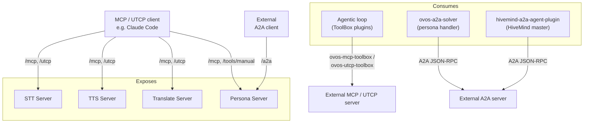

# Agent Interoperability: MCP, UTCP, and A2A

!!! abstract "In a nutshell"
    This page is about letting OVOS work *together with other AI systems*. OVOS can offer its abilities, like speech, translation, and reasoning, to outside AI tools. It can also call on them, using a few shared "languages" (the protocols MCP, UTCP, and A2A) so different systems can find and use each other. Think of it as agents agreeing on a common plug and socket so they can cooperate. See the [Glossary](glossary.md) for unfamiliar terms.

OVOS speaks three agent protocols, in both directions:

- **MCP** (Model Context Protocol) lets an AI assistant such as Claude Code discover and call tools on a server.
- **UTCP** (Universal Tool Calling Protocol) publishes a JSON manual that tells an agent how to call a server's own HTTP endpoints directly, with no wrapper process.
- **A2A** (Agent-to-Agent) lets one agent hand a whole conversation turn to another agent.

OVOS **exposes** its speech, translation, and reasoning services over MCP and UTCP, and its personas over A2A. OVOS also **consumes** these protocols: a persona can use tools from any MCP or UTCP server, and it can answer through a remote A2A agent.

!!! note "Not what you're looking for?"
    This page is about LLM/agent tool protocols. If you're building a voice
    satellite or a remote voice client instead, see [HiveMind Agents](hivemind-agents.md).



*Diagram:* The upper group shows the OVOS servers that external clients call over `/mcp`, `/utcp`, `/tools/manual`, and `/a2a`. The lower group shows the OVOS components that call external MCP, UTCP, and A2A servers.

---

## Which component does what

| Component | Protocol | Direction | What it does | Documentation |
|---|---|---|---|---|
| `ovos-stt-server` (pip: `ovos-stt-http-server`) | MCP, UTCP | Exposes | Speech-to-text as a `transcribe` tool | [STT Server](stt-server.md), [repository](https://github.com/OpenVoiceOS/ovos-stt-server) |
| `ovos-tts-server` | MCP, UTCP | Exposes | Text-to-speech as a `synthesize` tool | [TTS Server](tts-server.md), [repository](https://github.com/OpenVoiceOS/ovos-tts-server) |
| `ovos-translate-server` | MCP, UTCP | Exposes | Machine translation and language detection | [Translate Server](translate-server.md), [repository](https://github.com/OpenVoiceOS/ovos-translate-server) |
| `ovos-persona-server` | MCP, UTCP, A2A | Exposes | Installed tool plugins over MCP and UTCP; personas as A2A agents | [Persona Server](persona-server.md), [repository](https://github.com/OpenVoiceOS/ovos-persona-server) |
| `ovos-plugin-manager` (`ToolBox`) | Tool plugin contract | Both | The plugin interface that every tool, adapter, and bridge shares | [Agent Tool Plugins](tool-plugins.md) |
| `ovos-PHAL-plugin-tools` | Messagebus | Exposes | Installed tool plugins on the OVOS messagebus | [Agent Tool Plugins](tool-plugins.md#phal-bus-provider), [repository](https://github.com/OpenVoiceOS/ovos-PHAL-plugin-tools) |
| `ovos-agentic-loop` | Tool plugin contract | Consumes | Reasoning loops that call tool plugins for a persona | [Agentic Loops](agentic-loop.md), [repository](https://github.com/OpenVoiceOS/ovos-agentic-loop) |
| `ovos-tool-adapters` | MCP, UTCP | Consumes | External MCP and UTCP servers as tool plugins | [Consuming tools](#consuming-mcp-and-utcp-tools), [repository](https://github.com/OpenVoiceOS/ovos-tool-adapters) |
| `ovos-a2a-agent-plugin` (pip: `ovos-a2a-solver-plugin`) | A2A | Consumes | A persona handler that answers through a remote A2A agent | [OVOS as A2A consumer](#ovos-as-a2a-consumer), [repository](https://github.com/OpenVoiceOS/ovos-a2a-agent-plugin) |
| `hivemind-a2a-agent-plugin` | A2A | Consumes | A HiveMind agent protocol that routes satellite queries to a remote A2A agent | [HiveMind Agents](hivemind-agents.md), [repository](https://github.com/JarbasHiveMind/hivemind-a2a-agent-plugin) |

---

## Protocol overview

| Protocol | Discovery | Invocation | Server-side requirement |
|----------|-----------|------------|------|
| **UTCP** | `GET /utcp` returns a UTCP 1.0 manual (Persona Server: `GET /tools/manual`) | The client calls the native HTTP endpoints that the manual names (Persona Server: `POST /tools/{name}`) | None, always on |
| **MCP** | MCP `initialize` + `tools/list` | `tools/call` over Streamable HTTP at `/mcp` | The `mcp` extra **and** the `--mcp` flag |
| **A2A** | `GET /.well-known/agent-card.json` (agent card; `/.well-known/agent.json` kept for 0.3.x clients) | JSON-RPC 2.0 `SendMessage` / `SendStreamingMessage` (0.3.x clients: `message/send` / `message/stream`) | The `a2a` extra and the `--a2a-base-url` flag |

The `mcp` extra installs the third-party `fastmcp` package, which serves MCP. A client that connects to an MCP server uses the official `mcp` SDK instead.

### Tools each server offers

| Server | MCP tools | UTCP tools |
|---|---|---|
| STT (default port `8080`) | `transcribe(audio_b64 \| audio_path, lang="auto", sample_rate=16000, sample_width=2)` | `stt`, `lang_detect`, `status` |
| TTS (default port `9666`) | `synthesize(text, voice=None, lang=None)` returns base64 WAV, MIME type, a server-side file path, and phonemes | `tts_status`, `tts_synthesize_v2`, `tts_synthesize_legacy` |
| Translate (default port `9686`) | `translate(text, target_lang, source_lang=None)`, `detect_language(text)` | `ovos_translate.translate`, `ovos_translate.translate_with_source`, `ovos_translate.detect_language`, `ovos_translate.classify_language`, `ovos_translate.supported_languages` |
| Persona (default port `8337`) | One tool per tool of each installed `ToolBox` plugin | The same tools, in the manual at `/tools/manual` |

The STT `transcribe` tool reads `audio_b64` as raw PCM at the given sample rate and width. `audio_path` names a file on the **server's** file system.

---

## User stories

Each story uses the Translate Server, because the current UTCP and MCP clients load all of its tools. The same steps apply to the other servers. Change the port and the tool names, and read [Known limitations](#known-limitations) first.

All of these stories start the server with MCP turned on:

!!! warning "Alpha channel only"
    The `mcp` extra has a prerelease floor, so the server installs from the
    prerelease channel:

    ```bash
    pip install --pre "ovos-translate-server[mcp]>=0.10.0a1" ovos-google-translate-plugin
    ovos-translate-server --tx-engine ovos-google-translate-plugin --mcp
    ```

### Give Claude Code a translation tool

You use Claude Code and want it to translate text through your own OVOS server. Register the MCP endpoint:

```bash
claude mcp add --transport http ovos-translate http://localhost:9686/mcp
claude mcp get ovos-translate
```

`claude mcp get` reports `Status: ✔ Connected` and `Type: http`. Claude Code then lists the `translate` and `detect_language` tools. Remove the entry with `claude mcp remove ovos-translate`.

### Give Claude Desktop a translation tool

Claude Desktop starts MCP servers from `claude_desktop_config.json` as local commands (`command` and `args`). The file has no URL entry for a server on your network. The `mcp-remote` bridge closes the gap: Claude Desktop starts it as a local command, and it forwards to the HTTP endpoint. This needs Node.js.

```json
{
  "mcpServers": {
    "ovos-translate": {
      "command": "npx",
      "args": ["-y", "mcp-remote", "http://localhost:9686/mcp"]
    }
  }
}
```

Restart Claude Desktop after you edit the file. If the tools do not appear, read the `mcp*.log` files that Claude Desktop writes, and run the `npx` command by hand to see its error.

### Call the server from any UTCP agent

You have an agent built on the UTCP client library and want it to find the translation endpoints with no extra configuration. Point the client at `/utcp`. It reads the manual and calls the native endpoints directly:

```bash
pip install "utcp>=1.2.0" "utcp-http>=1.1.14"
```

```python
import asyncio
from utcp.utcp_client import UtcpClient

async def main():
    client = await UtcpClient.create(config={
        "manual_call_templates": [{
            "name": "ovos_translate",
            "call_template_type": "http",
            "url": "http://localhost:9686/utcp",
            "http_method": "GET",
        }]
    })
    for tool in await client.search_tools("translate", limit=10):
        print(tool.name)
    print(await client.call_tool("ovos_translate.translate_with_source",
                                 {"src_lang": "en", "tgt_lang": "pt", "utterance": "good morning"}))

asyncio.run(main())
```

The script prints the five `ovos_translate.*` tool names, then `bom dia`. The `utcp-http` package is required: without it, the client rejects every manual whose `call_template_type` is `http`.

### Call the server from your own MCP client

```python
import asyncio
from mcp import ClientSession
from mcp.client.streamable_http import streamable_http_client

async def main():
    async with streamable_http_client("http://localhost:9686/mcp") as (read, write):
        async with ClientSession(read, write) as session:
            await session.initialize()
            print([t.name for t in (await session.list_tools()).tools])
            result = await session.call_tool("translate", {"text": "good morning", "target_lang": "pt", "source_lang": "en"})
            print(result.content[0].text)

asyncio.run(main())
```

This uses the `mcp` SDK 2.x (`pip install "mcp>=2.3.0"`). It prints `['translate', 'detect_language']`, then `bom dia`.

### Let a persona use tools from an MCP server

You build an OVOS persona and want its reasoning loop to call tools that another server offers. Install the adapter and name it in the loop's `toolboxes`. The adapter's own settings go **inside** the loop's section, beside `toolboxes`:

```bash
pip install --pre ovos-agentic-loop "ovos-tool-adapters[mcp]"
```

```json
{
  "name": "translator",
  "handlers": ["ovos-react-loop"],
  "ovos-react-loop": {
    "brain": "ovos-chat-openai-plugin",
    "toolboxes": ["ovos-mcp-toolbox"],
    "ovos-mcp-toolbox": {
      "transport": "http",
      "url": "http://localhost:9686/mcp",
      "timeout": 30
    }
  }
}
```

The loop then offers `translate` and `detect_language` to its brain. If the adapter settings sit at the top level of the persona instead, the loop passes the adapter an empty config. The adapter then logs `MCPToolBox: failed to connect to MCP server: 'command'` and offers no tools.

The Persona Server's own tool endpoints (`/tools/*`, `/mcp`) are different. They load every installed toolbox, and they read each toolbox's section from the top level of the persona file that the `PERSONA_PATH` environment variable names.

### Let a persona answer through a remote A2A agent

You have an agent that speaks A2A and want an OVOS persona to hand each question to it. See [OVOS as A2A consumer](#ovos-as-a2a-consumer) for the configuration, and read the A2A entry in [Known limitations](#known-limitations) before you choose a server.

### Publish a persona as an A2A agent

You want other agents to reach an OVOS persona over A2A. Start the Persona Server with `--a2a-base-url`. See [Persona Server as A2A server](#persona-server-as-a2a-server).

---

## Known limitations

These limitations apply to the code on the `dev` branches. A fix for each one is **Upcoming**.

| Component | Limitation | What to do instead |
|---|---|---|
| STT Server `/utcp` | The manual's call templates use field names that the UTCP 1.x client does not read. The client registers no tools and logs `KeyError: 'call_template_type'`. | Use MCP, or call `/stt` directly. |
| TTS Server `/utcp` | The synthesis tools return WAV bytes, and the UTCP 1.x HTTP client fails with `UnicodeDecodeError` when it reads them. `tts_status` works. | Use the MCP `synthesize` tool, which returns base64 audio. |
| Translate Server | Text that contains `/` breaks the routes that carry the text in the URL path. The request returns `404`. This applies to the native endpoints and to the UTCP tools. | Remove `/` from the text, or use the MCP tools. |
| Persona Server `/tools/manual` | The manual does not follow the UTCP 1.0 schema. The UTCP 1.x client rejects it with a `ValidationError`. | Use MCP (`--mcp`), or `POST /tools/{name}` directly. |
| `ovos-utcp-toolbox` | The adapter imports a module that the UTCP 1.x client does not have. It loads no tools and logs `No module named 'utcp.client'`. | Use `ovos-mcp-toolbox`. |
| `ovos-a2a-solver`, `hivemind-a2a-agent-plugin` | Both send the early A2A method names `tasks/send` and `tasks/sendSubscribe`. An `a2a-sdk` 1.x server, the Persona Server's `/a2a` among them, answers `-32601 Method not found`. | Use an A2A server that accepts `tasks/send`. |
| Translate Server MCP `translate` | Without `source_lang`, the tool passes no source language to the translator plugin. A plugin that requires one fails. | Pass `source_lang`, or call `detect_language` first. |
| Translate Server | With `--mcp` but without the `mcp` extra, the server starts without `/mcp` and logs no warning. Requests to `/mcp` return `404`. | Install the `mcp` extra when you pass `--mcp`. |

!!! danger "No authentication on any agent endpoint"
    `/mcp`, `/utcp`, `/tools/*`, and `/a2a` accept every request. Any client that reaches the port can call every tool. The STT `transcribe` tool also reads any server file that `audio_path` names. Bind the servers to `127.0.0.1` or a trusted network. To serve other hosts, put a reverse proxy that adds authentication in front.

---

## Persona Server: tool plugins via MCP + UTCP

The Persona Server surfaces every installed OPM `ToolBox` plugin as UTCP tools and, with `--mcp`, as MCP tools.

```bash
pip install --pre "ovos-persona-server[mcp]"
ovos-persona-server --persona my_persona.json --mcp
```

| Endpoint | Method | Description |
|----------|--------|-------------|
| `/tools/manual` | GET | UTCP manual of all installed tool plugins |
| `/tools/{name}` | POST | Direct HTTP invocation of a tool |
| `/mcp` | Streamable HTTP | MCP server, one tool per OPM ToolBox tool (needs `--mcp` and the `mcp` extra) |
| stdio | — | Console script `ovos-persona-tools-mcp`, for MCP clients that start a local command |

---

## A2A (Agent-to-Agent Protocol)

A2A is an [open agent protocol](https://a2a-protocol.org/). An A2A server publishes a discovery document (agent card) and accepts tasks via JSON-RPC 2.0.

### Persona Server as A2A server

!!! warning "Alpha channel only"
    The `a2a` extra has a prerelease floor, so it installs from the prerelease
    channel:

    ```bash
    pip install --pre "ovos-persona-server[a2a]>=0.17.2a1"
    ```

The `OVOSPersonaAgentExecutor` wraps the active persona. `create_a2a_application()`
builds the A2A app, with an agent card at `/.well-known/agent-card.json` (the 0.3.x
`/.well-known/agent.json` path stays as a compat alias) and support for blocking
(`SendMessage`) and streaming (`SendStreamingMessage`) modes when the persona
solver supports streaming.

Start it with `--a2a-base-url`, which both enables the `/a2a` endpoint and sets the public
base URL that goes into the agent card:

```bash
ovos-persona-server --persona my.json --a2a-base-url http://myhost:8337/a2a
```

The flag needs `a2a-sdk` installed. See [Persona Server](persona-server.md).

### OVOS as A2A consumer

[OpenVoiceOS/ovos-a2a-agent-plugin](https://github.com/OpenVoiceOS/ovos-a2a-agent-plugin) (pip: `ovos-a2a-solver-plugin`) is an `A2AChatEngine` `ChatEngine` plugin (OPM group `opm.agents.chat`, entry point `ovos-a2a-solver`) that delegates persona reasoning to an external A2A server.

```json
{
  "name": "my-a2a-persona",
  "handlers": ["ovos-a2a-solver"],
  "ovos-a2a-solver": {
    "agent_url": "https://my-a2a-agent.example.com",
    "auth_header": "Bearer <token>",
    "timeout": 60,
    "streaming": false
  }
}
```

Config keys:

| Key | Default | Description |
|-----|---------|-------------|
| `agent_url` | — | Base URL of the A2A server (**required**) |
| `auth_header` | — | `Authorization` header value, e.g. `Bearer <token>` |
| `timeout` | `60` | Seconds per call |
| `streaming` | `false` | Use the SSE streaming endpoint when `true` |

[JarbasHiveMind/hivemind-a2a-agent-plugin](https://github.com/JarbasHiveMind/hivemind-a2a-agent-plugin) does the same job for a HiveMind master. It registers under the `hivemind.agent.protocol` entry-point group, and it takes the same four keys in the `hivemind.a2a_agent` section of the HiveMind configuration.

---

## Consuming MCP and UTCP tools

[OpenVoiceOS/ovos-tool-adapters](https://github.com/OpenVoiceOS/ovos-tool-adapters) bridges external MCP and UTCP servers into the OVOS agentic loop as standard `ToolBox` plugins.

```bash
pip install ovos-tool-adapters[mcp]     # MCP support
pip install ovos-tool-adapters[utcp]    # UTCP support
```

Add to a persona JSON. The adapter settings go inside the loop's section:

```json
{
  "name": "researcher",
  "handlers": ["ovos-react-loop"],
  "ovos-react-loop": {
    "brain": "ovos-chat-openai-plugin",
    "toolboxes": ["ovos-mcp-toolbox"],
    "ovos-mcp-toolbox": {
      "transport": "stdio",
      "command": "uvx",
      "args": ["mcp-server-fetch"],
      "timeout": 30
    }
  }
}
```

> `ovos-persona` selects its engine via `handlers` (see [Personas](personas.md) for the legacy `solvers` alias). The agentic loop names its inner LLM with `brain` and loads adapters via `toolboxes`. Neither `ovos-persona` nor `ovos-tool-adapters` reads the `chat_module` key seen in some READMEs.

### MCP transports (`ovos-mcp-toolbox`)

| Transport | Config |
|-----------|--------|
| stdio (subprocess) | `"transport": "stdio", "command": "uvx", "args": [...]`, optional `"env": {...}` |
| SSE | `"transport": "sse", "url": "http://..."` |
| Streamable HTTP | `"transport": "http", "url": "http://..."` |

For stdio, `env` is an optional dict of extra environment variables passed to
`StdioServerParameters`, letting you inject secrets or `PATH` into the subprocess
MCP server. Both `ovos-mcp-toolbox` and `ovos-utcp-toolbox` also accept a
per-instance `toolbox_id` (defaults `ovos-mcp-toolbox` / `ovos-utcp-toolbox`) so
multiple servers of the same type can run side by side, and a `timeout` (default
30 seconds per call) to tune slow tools.

### UTCP (`ovos-utcp-toolbox`)

`ovos-utcp-toolbox` loads no tools with the UTCP 1.x client. See [Known limitations](#known-limitations). Use `ovos-mcp-toolbox` with the servers above.

A background asyncio event loop keeps sessions alive between tool calls. Each server's JSON Schema is translated to a Pydantic model at discovery time so the LLM receives the actual input schema.

Tool discovery degrades gracefully: if the `mcp`/`utcp` extra is missing, or the
configured server cannot be reached, `list_tools()` logs a `LOG.warning` and
returns an empty list rather than crashing the agent loop. A misconfigured
toolbox therefore loads zero tools silently. Check the logs when expected tools
are absent.

!!! note "`ovos-tool-adapters` and the Persona Server's own MCP/UTCP bridge"
    Both `MCPToolBox` and `UTCPToolBox` (from `ovos-tool-adapters`) and the Persona Server's tool
    surface (`/tools/manual`, `/mcp`) are `ToolBox` plugins under the same `opm.agents.toolbox`
    entry-point group, so installing `ovos-tool-adapters` alongside `ovos-persona-server` also
    exposes the bridged external tools through the Persona Server's own MCP/UTCP endpoints.
    Every `ToolBox` implementation (`DuckDuckGoToolbox`, `WikipediaToolbox`, `MCPToolBox`,
    `UTCPToolBox`, ...) takes `(config=None, bus=None)` and passes its own `toolbox_id` up
    to the base class, so the Persona Server constructs each one with a single
    `cls(config=cfg, bus=bus)` call. See [Agent Tool Plugins](tool-plugins.md) for the
    full contract.

---
**Read next:** [OpenAI-compatible](openai-plugin.md)
**Related:** [Agent Tool Plugins](tool-plugins.md) · [GGUF / Local LLM](gguf-plugin.md)
