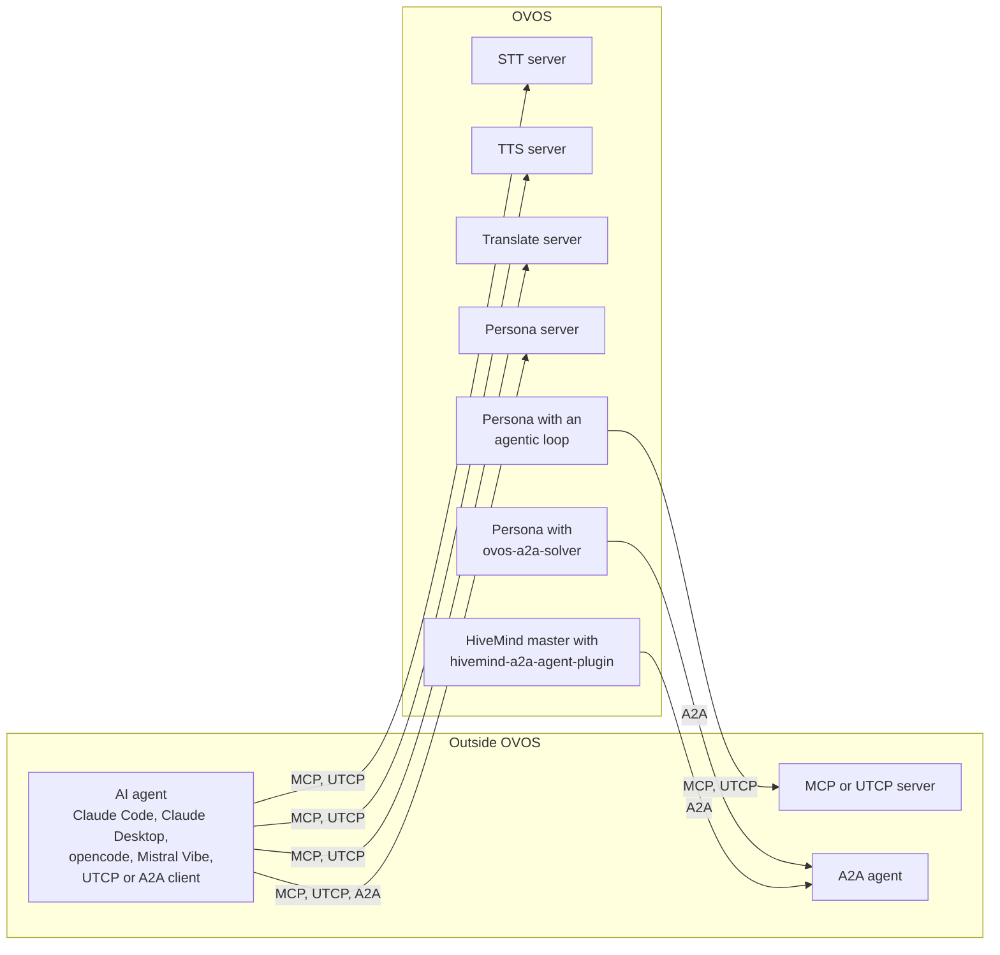

# AI Agents: MCP, UTCP and A2A

!!! abstract "In a nutshell"
    OpenVoiceOS (OVOS) can give its speech, translation and reasoning abilities to outside AI agents, and it can use tools and agents that live outside OVOS. Three open protocols make this work: MCP, UTCP and A2A. Each page in this section is one task that you can do, with the exact steps and the real output.

## What you can do

| What you can do | Task | Component | Component docs |
|---|---|---|---|
| Transcribe speech from Claude Code, Claude Desktop, opencode, Mistral Vibe or any MCP or UTCP agent | [Transcribe audio from an AI agent](ai-agent-transcribe.md) | `ovos-stt-server` | [AI agent integration](https://github.com/OpenVoiceOS/ovos-stt-server#ai-agent-integration) |
| Make speech from an AI agent | [Let an AI agent speak](ai-agent-speak.md) | `ovos-tts-server` | [Agent integration](https://github.com/OpenVoiceOS/ovos-tts-server#agent-integration) |
| Translate text and detect its language from an AI agent | [Translate text from an AI agent](ai-agent-translate.md) | `ovos-translate-server` | [AI agent integration](https://github.com/OpenVoiceOS/ovos-translate-server#ai-agent-integration) |
| Let other agents talk to an OVOS persona | [Talk to an OVOS persona over A2A](ai-agent-a2a-server.md) | `ovos-persona-server` | [A2A endpoint](https://github.com/OpenVoiceOS/ovos-persona-server#a2a-endpoint) |
| Write a tool that every OVOS agent component can use | [Write a tool plugin](ai-agent-tool-plugin.md) | `ovos-plugin-manager` | [Agents](https://github.com/OpenVoiceOS/ovos-plugin-manager/blob/dev/docs/agents.md) |
| Call the tools of a persona from an AI agent | [Use persona tools over MCP and UTCP](ai-agent-persona-tools.md) | `ovos-persona-server` | [API surfaces](https://github.com/OpenVoiceOS/ovos-persona-server#api-surfaces) |
| Share tools with every program on an OVOS device | [Share tools on the messagebus](ai-agent-bus-tools.md) | `ovos-PHAL-plugin-tools` | [Bus API reference](https://github.com/OpenVoiceOS/ovos-PHAL-plugin-tools#bus-api-reference) |
| Give a persona tools from an MCP or UTCP server | [Give a persona MCP and UTCP tools](ai-agent-persona-uses-tools.md) | `ovos-agentic-loop`, `ovos-tool-adapters` | [Toolboxes](https://github.com/OpenVoiceOS/ovos-agentic-loop/blob/dev/docs/toolboxes.md), [MCP](https://github.com/OpenVoiceOS/ovos-tool-adapters/blob/dev/docs/mcp.md), [UTCP](https://github.com/OpenVoiceOS/ovos-tool-adapters/blob/dev/docs/utcp.md) |
| Let a persona answer through an agent on another server | [Answer through a remote A2A agent](ai-agent-a2a-solver.md) | `ovos-a2a-agent-plugin` | [Settings](https://github.com/OpenVoiceOS/ovos-a2a-agent-plugin#settings) |
| Connect HiveMind voice satellites to an A2A agent | [Connect a HiveMind satellite to an A2A agent](ai-agent-hivemind-a2a.md) | `hivemind-a2a-agent-plugin` | [Settings](https://github.com/JarbasHiveMind/hivemind-a2a-agent-plugin#settings) |

## The three protocols

- **MCP** (Model Context Protocol) lets an AI assistant, such as Claude Code, Claude Desktop, opencode or Mistral Vibe, find and call the tools of a server.
- **UTCP** (Universal Tool Calling Protocol) gives an agent a JSON manual at `GET /utcp`. The manual tells the agent how to call the server's own HTTP endpoints, so no wrapper process is necessary.
- **A2A** (Agent-to-Agent) lets one agent give a full question to another agent and get the answer back.

| Protocol | How an agent finds the tools | How an agent calls a tool | What the server needs |
|---|---|---|---|
| UTCP | `GET /utcp` returns a UTCP 1.0 manual | The agent calls the HTTP endpoints that the manual names | Nothing. The endpoint is always on. |
| MCP | MCP `initialize` and `tools/list` at `/mcp` | MCP `tools/call` over Streamable HTTP | The `mcp` extra and the `--mcp` flag |
| A2A | `GET /a2a/.well-known/agent-card.json` | JSON-RPC 2.0 `SendMessage` | The `a2a` extra and the `--a2a-base-url` flag |

*Diagram:* On the left, outside agents call the four OVOS servers. On the right, three OVOS components call tools and agents outside OVOS.

## Default ports

| Server | Command | Default port |
|---|---|---|
| STT | `ovos-stt-server` | `8080` |
| TTS | `ovos-tts-server` | `9666` |
| Translate | `ovos-translate-server` | `9686` |
| Persona | `ovos-persona-server` | `8337` |

## Security

!!! danger "The agent endpoints have no authentication"
    `/mcp`, `/utcp`, `/tools/*` and `/a2a` accept every request. Any client that can reach the port can call every tool. Bind the servers to `127.0.0.1` or to a trusted network. To serve other hosts, put a reverse proxy with authentication in front of the server.

---
**Read next:** [Transcribe audio from an AI agent](ai-agent-transcribe.md)
**Related:** [Agent Tool Plugins](tool-plugins.md) · [Agentic Loops](agentic-loop.md) · [Persona Server](persona-server.md)
