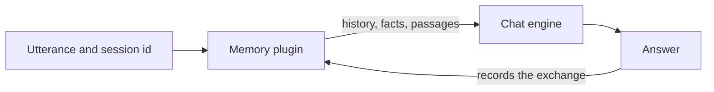

# Personas and Memory

--8<-- "snippets/alpha-only.md"

!!! abstract "In a nutshell"
    A persona is a named assistant with its own chat engine and its own memory. Each page in this section is one task that you can do with personas and memory, with the exact steps and the output of a real run.

## What you can do

| What you can do | Page | Component | Component docs |
|---|---|---|---|
| Make a persona remember what you said, also after a restart | [Make a persona remember](persona-remember.md) | `ovos-persona`, `ovos-memory-plugins` | [Memory](https://github.com/OpenVoiceOS/ovos-persona/blob/dev/docs/memory.md) |
| Give each person in a family their own memory | [Give each person their own memory](persona-family-memory.md) | `ovos-memory-plugins`, `ovos-persona-server` | [Recall scope](https://github.com/OpenVoiceOS/ovos-memory-plugins/blob/dev/docs/overview.md) |
| Answer from your own documents with no cloud service | [Answer from your own documents](persona-local-documents.md) | `ovos-memory-plugins` | [Lexical memory](https://github.com/OpenVoiceOS/ovos-memory-plugins/blob/dev/docs/lexical.md) |
| Use a different persona on each device | [Use a persona per device](persona-per-device.md) | `ovos-persona` | [Persona service](https://github.com/OpenVoiceOS/ovos-persona/blob/dev/docs/persona-service.md) |
| Serve several personas from one HTTP server | [Run several personas on one server](persona-several-on-one-server.md) | `ovos-persona-server` | [Several personas](https://github.com/OpenVoiceOS/ovos-persona-server/blob/dev/docs/multi-persona.md) |
| Port a solver plugin to the agent engine classes | [Move from solver plugins](persona-solver-migration.md) | `ovos-plugin-manager` | [Agents](https://github.com/OpenVoiceOS/ovos-plugin-manager/blob/dev/docs/agents.md) |

## How memory works

A persona sends a list of messages to its chat engine for each answer. The memory plugin builds that list. It adds the history of the session, and it can add recalled facts, a summary or passages from your documents.

Each conversation has a session id. A device has its own session, and the persona server uses the OpenAI `user` field as the session. The memory plugin keeps a separate history for each session. The persona server trusts the `user` value and does not check it, so it fits trusted clients only.



*Diagram:* the memory plugin builds the prompt from the utterance and the session history. The chat engine answers. The memory plugin records the exchange for the next turn.

## Memory plugins

| Plugin entry point | What it keeps | Survives a restart |
|---|---|---|
| `ovos-agents-short-term-memory-plugin` | The last messages of each session, in RAM. This is the default. | No |
| `ovos-memory-plugin-recency` | The last messages of each session | Only with `db_path` set |
| `ovos-memory-plugin-entity` | Facts about the user, which the chat model extracts | Yes |
| `ovos-memory-plugin-longterm` | A rolling summary of each session | Yes |
| `ovos-memory-plugin-lexical` | Exchanges and documents in a local SQLite full-text index | Yes |
| `ovos-memory-plugin-local-rag` | Exchanges and documents in a local vector index | Yes |
| `ovos-memory-plugin-composite` | Several of the above, merged | Depends on the members |
| `ovos-openai-rag-memory-plugin` | Nothing. It reads passages from a vector store on `ovos-persona-server` | Yes, on the server |

## One setting that every memory recipe needs

`ovos-chat-openai-plugin` removes system messages unless `allow_system_prompts` is `true`. Most memory plugins add their context as a system message. Without the setting, the persona answers as if it remembers nothing, and the log says:

```text
dropped 1 system message(s) before the request: 'allow_system_prompts' is off.
```

Set `"allow_system_prompts": true` in the `ovos-chat-openai-plugin` block of the persona.

## Related pages

- [Personas](personas.md): the persona file format and the persona service.
- [Persona Memory](persona-memory.md): the memory plugin interface and every backend.
- [Persona Server](persona-server.md): the HTTP server for personas.
