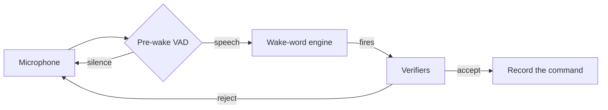

# Wake Word Guide

--8<-- "snippets/alpha-only.md"

Each page below does one wake-word task from start to end. Each page gives the commands, the configuration and the real output. Where a page gives a rate, the page also tells you which data and which command gave the rate.

## Find your task

| You want to | Read |
|---|---|
| Use any phrase as the wake word, with no training | [Change the Wake Word Without Training](change-wake-word-without-training.md) |
| Train a model for your own name, or any phrase | [Train a Wake Word for Your Name](ww-own-name.md) |
| Make training data for a wake word, with no recordings | [Generate a Wake-word Dataset](ww-dataset.md) |
| Select the engine that makes the fewest errors for a known phrase | [Pick a Wake-word Engine from the Benchmark](ww-pick-engine.md) |
| Measure engines and settings on your own recordings | [Compare Wake-word Engines on Your Audio](ww-compare.md) |
| Stop the assistant waking up from the TV, a radio or noise | [Stop Wake-ups from the TV](ww-tv.md) |
| Let only the people in your household wake the assistant | [Make OVOS Answer Only Your Voice](answer-only-your-voice.md) |
| Get fewer false activations, or fewer missed wake words | [Tune False Activations](ww-tune.md) |

## The parts of wake-word detection

The listener sends each audio chunk through these steps:

*Diagram:* audio goes from the microphone to the pre-wake VAD. Speech goes to the wake-word engine. When the engine fires, the verifiers can accept or reject the detection. An accepted detection starts the recording of the command.

- The **pre-wake VAD** runs the wake-word engine only after it hears speech. See [Wake-word Verifier Plugins](ww-verifier.md#pre-wake-vad).
- The **wake-word engine** detects the phrase. See [Wake-word Plugins](wake-word-plugins.md).
- The **verifiers** check the audio of the detection a second time. See [Wake-word Verifier Plugins](ww-verifier.md).

## Two words that the pages use

- **Recall**: the share of real wake words that the assistant detects. A recall of 90% misses 1 wake word in 10.
- **False activations per hour (FA/h)**: how many times per hour of other audio the assistant wakes up with no wake word.

A change that gives fewer false activations usually also gives a lower recall. [Tune False Activations](ww-tune.md) shows how to find the setting that is correct for you.

## Models, data and tools

| Resource | What it is |
|---|---|
| [OpenVoiceOS/wakehubert-wakewords](https://huggingface.co/OpenVoiceOS/wakehubert-wakewords) | The trained wake-word models that `ovos-ww-plugin-wakeforge` loads by name, with recall and false activations per hour for each. Try them in the browser in the [demo Space](https://huggingface.co/spaces/OpenVoiceOS/wakehubert-wakewords-space). |
| [TigreGotico/wakephonehubert](https://huggingface.co/TigreGotico/wakephonehubert) | The phone model of the zero-shot engine. It takes any wake word as an IPA string and needs no training. Try it in the [demo Space](https://huggingface.co/spaces/TigreGotico/wakephonehubert-space). |
| [TigreGotico/wakehubert-tiny](https://huggingface.co/TigreGotico/wakehubert-tiny) | The small speech encoder that the trained models run on, distilled from HuBERT. |
| [TigreGotico/wakeforge](https://github.com/TigreGotico/wakeforge) | The framework that generates datasets and trains, evaluates and exports wake-word models. |
| [Synthetic dataset notebook](https://github.com/OpenVoiceOS/ngi0-notebooks/blob/dev/notebooks/synthetic_ww_dataset.ipynb) | Makes a wake-word dataset from text in a free Kaggle or Colab notebook. |
| [Kaggle quickstart notebook](https://github.com/OpenVoiceOS/ngi0-notebooks/blob/dev/notebooks/kaggle_quickstart_ww.ipynb) | Trains a wake-word model in a free Kaggle notebook. |
| [ovos-plugin-arena](https://openvoiceos.github.io/ovos-plugin-arena/) | The benchmark board of wake-word engines. See [Pick a Wake-word Engine from the Benchmark](ww-pick-engine.md). |

`ovos-ww-plugin-wakewordlab` is in the benchmark for comparison only. Its models are for non-commercial use, and its training code is not public.

## Further reading

- [Precise wake-word engine goes ONNX](https://blog.openvoiceos.org/posts/2025-11-03-precise-onnx)
- [The pre-wake VAD](https://blog.openvoiceos.org/posts/2025-11-06-prewake-vad)
- [Speaker verification](https://blog.openvoiceos.org/posts/2026-09-26-speaker-verifier)
- [WakeHuBERT and the wakeforge plugin](https://blog.openvoiceos.org/posts/2026-10-02-wakeforge-wake-words)
